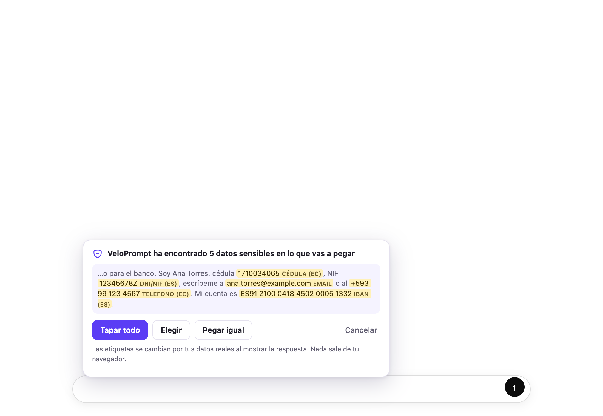
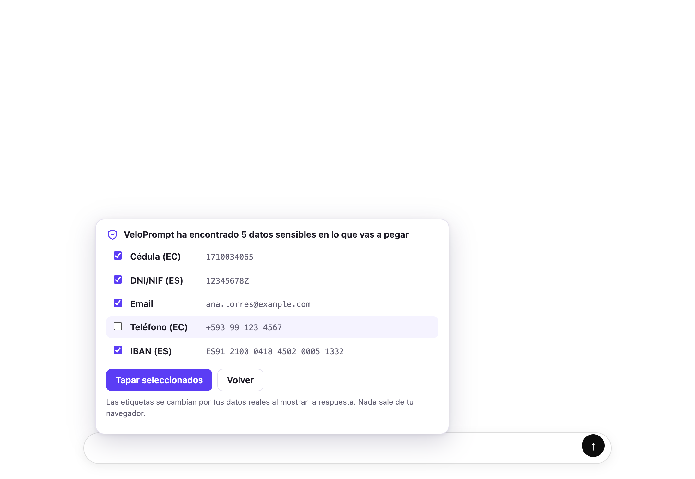
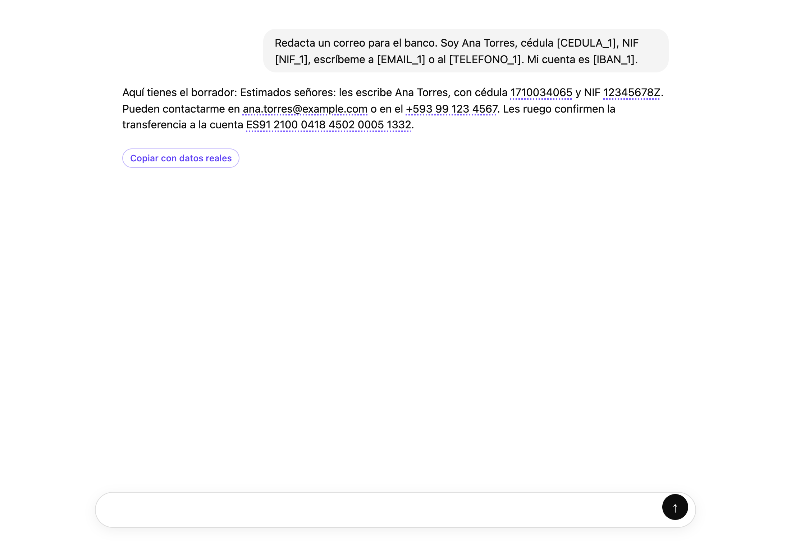
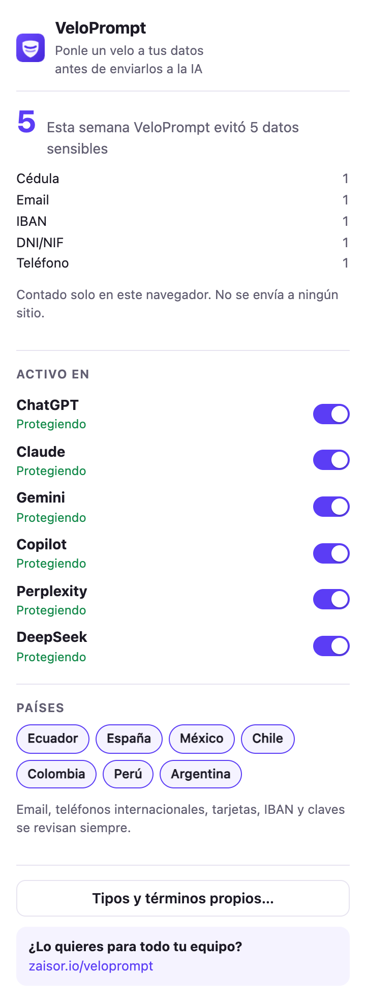

# VeloPrompt · extensión de navegador

Extensión Manifest V3 para Chrome y Edge, hecha con [WXT](https://wxt.dev) sobre
[`veloprompt-core`](../../packages/veloprompt-core). Antes de pegar o enviar un mensaje en
**ChatGPT, Claude, Gemini, Copilot, Perplexity o DeepSeek**, detecta datos sensibles y te ofrece taparlos con etiquetas
(`[CEDULA_1]`, `[NIF_1]`…). En la respuesta de la IA, las etiquetas se ven con tus datos reales,
solo en tu pantalla.

- **Permisos:** `storage` y acceso únicamente a los dominios de esos chats (`chatgpt.com`,
  `claude.ai`, `gemini.google.com`, `copilot.microsoft.com`, `perplexity.ai`, `chat.deepseek.com`).
  Nada de `<all_urls>`, sin service worker y sin ninguna petición de red. La lista vive en
  `src/lib/sites.ts` y de ahí salen el manifiesto, el adaptador y los ajustes.
- **Memoria:** el mapa etiqueta → valor vive solo en la memoria de la pestaña, uno por conversación.
  No se guarda en `storage` y se pierde al cerrar la pestaña.
- **En `chrome.storage.local`:** ajustes (sitios, países, tipos, términos propios) y el contador semanal.

## Probarla sin empaquetar

```bash
pnpm install
pnpm --filter veloprompt-extension build      # genera apps/extension/dist/chrome-mv3
```

1. Abre `chrome://extensions` (en Edge, `edge://extensions`).
2. Activa **Modo de desarrollador**.
3. Pulsa **Cargar descomprimida** y elige la carpeta `apps/extension/dist/chrome-mv3`.
4. Fija el icono de VeloPrompt en la barra y abre cualquiera de los chats (recarga las pestañas que ya estuvieran abiertas).
5. Copia un texto con datos de prueba, por ejemplo
   `Soy Ana, cédula 1710034065, NIF 12345678Z, correo ana@example.com`, y pégalo en el chat.

Tras cambiar el código: `pnpm --filter veloprompt-extension build` y el botón ↻ de la extensión en
`chrome://extensions`. Con `pnpm --filter veloprompt-extension dev`, WXT abre un Chrome aparte con recarga automática.

> No uses `dist/chrome-mv3-e2e`: es la compilación de los tests, con permiso extra para `127.0.0.1:4173`.

## Cómo funciona

| Momento | Qué hace |
| --- | --- |
| Pegar | Escucha `paste` en captura. Si hay datos, cancela el pegado y muestra el aviso: **Tapar todo** (por defecto, Enter), **Elegir** (casillas), **Pegar igual** o Esc para cancelar. |
| Enviar | Enter sin Shift en el editor y clic en el botón de enviar, en captura. Revisa el texto completo (por si escribiste datos a mano), tapa en el sitio con `execCommand("insertText")` y reenvía. |
| Respuesta | `MutationObserver`: cuando la respuesta deja de cambiar (fin del streaming), cambia las etiquetas conocidas por el valor real con subrayado punteado y el tooltip "Dato restaurado por VeloPrompt (la IA nunca lo vio)". Añade **Copiar con datos reales**. |

Para modificar el editor nunca se toca `innerText` ni `.value`: se usa `insertText` o un `paste`
sintético con `DataTransfer` (y, en un textarea, el setter nativo más un evento `input` como último
recurso), de modo que el estado interno del editor se actualiza.

| Sitio | Editor | Adaptador |
| --- | --- | --- |
| ChatGPT | ProseMirror | `src/adapters/chatgpt.ts` |
| Claude | ProseMirror | `src/adapters/claude.ts` |
| Gemini | Quill | `src/adapters/gemini.ts` |
| Copilot | textarea (React) | `src/adapters/copilot.ts` |
| Perplexity | Lexical (y textarea antiguo) | `src/adapters/perplexity.ts` |
| DeepSeek | textarea (React) | `src/adapters/deepseek.ts` |

Todos se crean con `createSiteAdapter` (`src/adapters/site-adapter.ts`) y comparten la interfaz
`getEditor()`, `getText()`, `setText()`, `onSend()`, `getResponseContainers()` (más
`replaceRanges()`, `submit()` y `conversationKey()`).

## Tests

```bash
pnpm --filter veloprompt-extension test          # Vitest: semana ISO, ajustes, vista previa, sesiones
pnpm --filter veloprompt-extension test:browser  # Playwright: adaptadores + E2E con la extensión cargada
pnpm --filter veloprompt-extension screenshots   # regenera docs/capturas/*.png
```

Los tests de navegador usan páginas locales (`tests/pages/`) que imitan el editor (ProseMirror,
Quill, Lexical o textarea de React) y el contenedor de respuestas de cada uno de los 6 sitios. Cada
editor falso tiene un estado interno propio y envía ese estado: si la extensión solo cambiara el
DOM, los tests fallarían. Nunca se usan las webs reales.

## Capturas

| Aviso al pegar | Elegir |
| --- | --- |
|  |  |

| Respuesta restaurada | Popup |
| --- | --- |
|  |  |

## Lo que aún no funciona o no está probado

- **ChatGPT y Claude se han probado en las webs reales; Gemini, Copilot, Perplexity y DeepSeek
  todavía no.** Sus selectores están puestos según la estructura conocida de cada web y pueden haber
  cambiado. Si algo no responde, el ajuste está en el adaptador de ese sitio.
- **Botón de enviar por `aria-label`** (Claude, Gemini, Copilot, Perplexity): se busca en inglés o en
  español. Enter funciona en cualquier idioma.
- **DeepSeek:** su botón de enviar no tiene etiqueta ni identificador estable; se toma el último botón
  de la caja del mensaje. Si añaden otro botón detrás, habría que ajustarlo.
- **Restaurar choca con React en casos raros:** si la web vuelve a dibujar una respuesta ya restaurada,
  las etiquetas reaparecen un instante hasta que el observador las vuelve a cambiar. El botón
  "Copiar con datos reales" puede desaparecer si la web rehace el contenedor.
- **Etiquetas que la IA modifica** (`[cedula_1]`, `CEDULA_1` sin corchetes, o partidas por formato
  Markdown) no se restauran.
- **Arrastrar y soltar texto** al editor no se intercepta (solo pegar y enviar). Los archivos adjuntos
  y las imágenes no se revisan.
- **Envío por otras vías** (atajos de teclado propios de la web, botón de "editar mensaje" y reenviar,
  modo voz) no se revisa todavía.
- **Sesión al cambiar de pestaña o recargar:** el mapa vive en memoria; si recargas la página,
  las respuestas antiguas ya no se restauran (es intencionado: nada se guarda en disco).
- **Firefox:** no probado esta semana.
